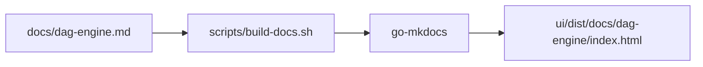

## Context

The DAG engine implementation is complete and all functional requirements in `openspec/specs/dag-engine/spec.md` are marked as implemented. The only remaining item is REQ-1, which requires the DAG engine documentation to be included in the project-docs site and emitted into `ui/dist/docs`. The docs site is generated by `scripts/build-docs.sh` using `go-mkdocs` from the `./docs` directory.

## Goals / Non-Goals

**Goals:**
- Create `docs/dag-engine.md` with user-facing documentation for the DAG engine.
- Ensure `scripts/build-docs.sh` includes the new page in the generated site under `ui/dist/docs`.
- Update the `dag-engine` spec to reflect that REQ-1 is satisfied.

**Non-Goals:**
- Adding new DAG engine features or changing engine behaviour.
- Restructuring the whole project-docs site.
- Writing docs for unrelated capabilities.

## Decisions

1. **Single markdown file in `docs/`**
   - `go-mkdocs` processes every markdown file in `./docs`, so adding `docs/dag-engine.md` is sufficient.
   - *Alternative:* create a subdirectory with multiple files. Rejected because one concise page covers the engine well enough for the current MVP.

2. **Update the main spec via a delta spec**
   - The change creates `openspec/changes/dag-engine-docs/specs/dag-engine/spec.md` with a `MODIFIED` section updating REQ-1.
   - *Alternative:* edit `openspec/specs/dag-engine/spec.md` directly. Rejected to keep the OpenSpec delta workflow intact.

3. **Verification by running the docs build**
   - After writing the doc, run `bash scripts/build-docs.sh` and confirm that `ui/dist/docs/dag-engine/index.html` exists.

## Documentation Flow

## Security Considerations

- No new API endpoints or dynamic content are introduced.
- The documentation page is static markdown converted to HTML.
- No user input is processed during the docs build.

## Risks / Trade-offs

- **go-mkdocs may fail on missing dependencies** – the build script installs the tool, but network access is required on first run.
  - *Mitigation:* the script handles installation; if it fails, the error will be visible in CI.
- **Doc page may not be linked from overview** – users may not discover it.
  - *Mitigation:* add a link to the DAG engine page from `docs/overview.md` and `docs/architecture.md`.

## Migration Plan

1. Write `docs/dag-engine.md`.
2. Add links from `docs/overview.md` and `docs/architecture.md`.
3. Run `bash scripts/build-docs.sh`.
4. Verify `ui/dist/docs/dag-engine/index.html` is generated.
5. Create the delta spec updating REQ-1.
6. Run `make test` to ensure no regressions.

## Open Questions

- Should the docs page include runnable code examples? (Could be added later; out of scope for this change.)
