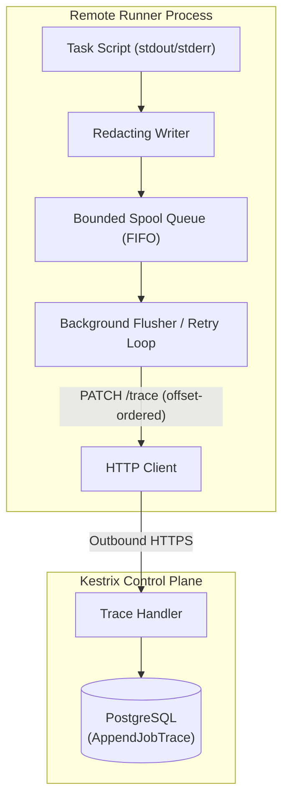

# Design: runner-offline-trace-spooling

## Context

In remote execution mode, the runner captures task stdout and stderr through `traceWriter` (`cmd/kestrix/runner.go`). During task execution, `traceWriter` transmits output in chunks via `PATCH /api/runner-jobs/{id}/trace` with a monotonic offset and claim epoch. If network connectivity drops momentarily (e.g. Wi-Fi reconnection or transient routing glitch), HTTP requests fail. Currently, unsent chunks are lost, leading to gaps in logs and consecutive offset rejection (`409` or `400`) by PostgreSQL row checks.

## Architecture

## Goals / Non-Goals

**Goals:**
- Provide zero trace loss during transient network disconnects up to the spool limit.
- Maintain monotonic chunk offset continuity across retried batches.
- Ensure all pending chunks are transmitted before sending job completion.
- Fail fast and drop spool if a stale epoch is detected (409 Conflict).

**Non-Goals:**
- Heavy persistent database engines (e.g. SQLite) on remote runners.
- Bypassing the server's silent-runner recovery timeout (reclaim epoch mechanism remains authoritative).

## Decisions

### 1. In-memory circular buffer with bounded byte cap vs. disk spooling
- **Chosen:** In-memory queue of chunks with an explicit capacity limit (`KESTRIX_RUNNER_TRACE_SPOOL_MAX_BYTES`, default 10 MiB).
- **Rationale:** Simpler, cross-platform (Linux/macOS), zero file permission or disk cleanup issues on client machines. 10 MiB accommodates hundreds of thousands of lines of output during multi-minute network outages.
- **Alternative considered:** Temporary file FIFO. Adds file locking complexity, disk exhaustion risks, and cleanup overhead on crash.

### 2. Flush-before-complete synchronization
- **Chosen:** When task execution terminates, the completion reporter waits for `spool.Flush(ctx)` to empty the queue before invoking `PUT /api/runner-jobs/{id}/complete`.
- **Rationale:** Guarantees that complete trace output is present in the database prior to transitioning task result to `passed` or `failed`.

### 3. Handling epoch invalidation (HTTP 409 Conflict)
- **Chosen:** If the server returns HTTP 409 Conflict on a trace chunk, the flusher marks the spool dead and immediately halts without retry.
- **Rationale:** 409 indicates the server has already reclaimed the job after silence and incremented the claim epoch. Further trace writes will never be accepted.

## Security Considerations

- Secret redaction continues to occur in memory via `redact.NewWriter()` *before* bytes enter the spool queue. Spooled memory never contains unredacted secrets.
- Runner bearer tokens are authenticated on every retried chunk request.

## Risks / Trade-offs

- **[Prolonged outage exceeds spool limit]** → Oldest chunks are truncated and replaced by a distinct truncation marker `[... output truncated due to offline buffer limit ...]`, keeping latest output and byte offsets sound.
- **[Network outage exceeds reclaim timeout]** → The server reclaims the job. The runner encounters HTTP 409 on next flush attempt, purges the spool, and terminates cleanly.
