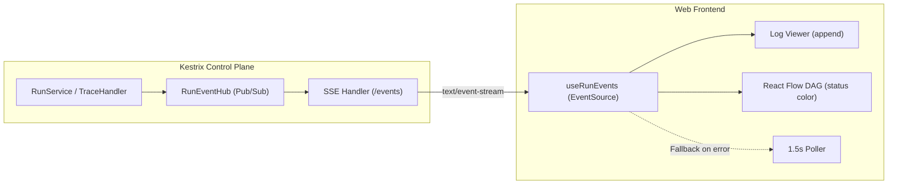

# Design: ui-realtime-sse

## Context

Today, `Pipelines.jsx` uses a short-polling loop (`setInterval` every 1500 ms) calling `GET /api/projects/{name}/runs/{id}` to refresh run detail, node statuses, and output. When runs produce rapid logs or have many tasks, polling introduces choppy output rendering, latency up to 1.5 seconds, and redundant database queries.

## Architecture

## Goals / Non-Goals

**Goals:**
- Provide instantaneous trace chunk and task state updates in the UI.
- Minimize database read traffic during active pipeline runs.
- Maintain transparent fallback to periodic polling if SSE connections fail.
- Keep resource footprint low with lightweight in-memory Go channels.

**Non-Goals:**
- Full bidirectional WebSocket infrastructure.
- SSE history replay (initial state is hydrated via standard `GET /api/projects/{name}/runs/{id}`, followed by SSE delta stream).

## Decisions

### 1. Server-Sent Events (SSE) vs. WebSockets
- **Chosen:** SSE over standard HTTP (`text/event-stream`).
- **Rationale:** SSE is simple, unidirectional, works over HTTP/1.1 and HTTP/2, requires no extra handshakes or protocols, and is natively supported by modern browsers through `EventSource`.
- **Alternative considered:** WebSockets. Requires bidirectional connection upgrades, protocol switching, and custom framing for purely server-to-client notifications.

### 2. In-memory `RunEventHub`
- **Chosen:** Simple Go in-memory pub/sub broker per active run.
- **Rationale:** Kestrix runs as a single control plane process. Subscribers register a channel `chan RunEvent` mapped by `run_id`. When `RunService` or `AppendJobTrace` records a change, it broadcasts non-blocking to registered subscriber channels.

### 3. Graceful fallback on connection drop
- **Chosen:** If `EventSource` triggers `onerror` or fails, the frontend automatically falls back to the existing 1.5-second polling interval.
- **Rationale:** Transparent resilience against aggressive intermediate corporate proxies or network glitches.

## Security Considerations

- The SSE endpoint enforces existing user session authentication (`requireAuth`).
- Project-level authorization verifies that the authenticated user has viewer or operator permissions on the project.
- Secrets are redacted server-side before broadcasting trace events.

## Risks / Trade-offs

- **[Proxy buffering / timeout]** → Handlers send a heartbeat comment (`: ping\n\n`) every 15 seconds to keep proxies from terminating idle connections.
- **[Slow client goroutine leak]** → Channels use bounded buffer (e.g. 64 events); slow clients that block are dropped with stream closure rather than blocking the runner or control plane.
