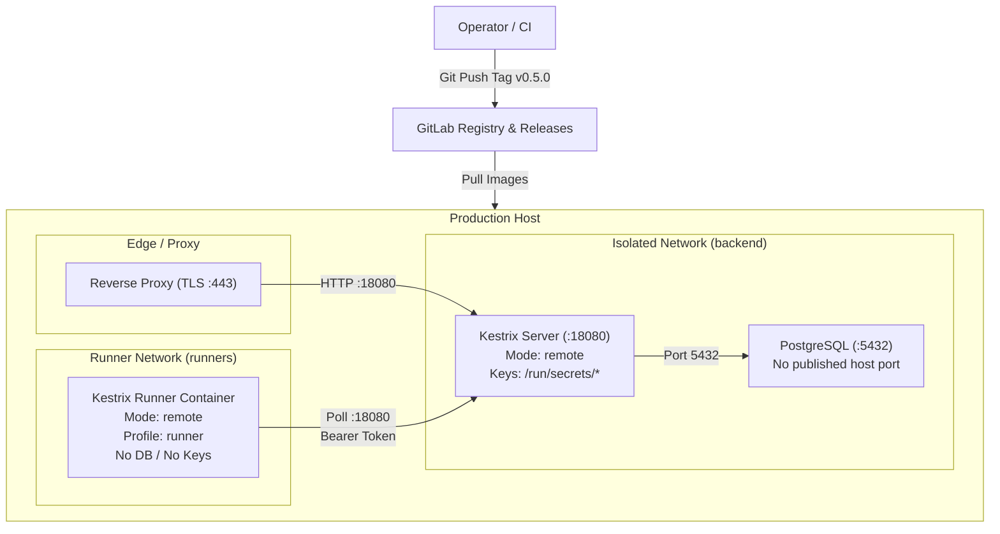

# Design: initial-production-deployment

## Context

Kestrix is currently built and verified via unit tests, integration tests against test databases, and localized Docker execution scripts. The official release mechanism (`scripts/release.sh`) and production compose setup (`docker/docker-compose.prod.yml`) have been developed but not executed against a live target host. Task 4.1 from `release-publishing` was intentionally deferred to when an operational host is ready.

## Goals / Non-Goals

**Goals:**
- Provide a clear, repeatable execution sequence for publishing `v0.5.0` and rolling out Kestrix to a production host.
- Enforce strict network and credential separation between the Kestrix control plane, PostgreSQL, and runner execution processes.
- Validate end-to-end operation through automated health checks, admin setup, runner registration, and an initial dogfood pipeline run.

**Non-Goals:**
- Automated multi-node cloud orchestration or Kubernetes operator development.
- Zero-downtime rolling database schema migrations (handled via standard Compose restart).

## Architecture

## Decisions

### D1: Use single-node hardened Compose with separate Docker networks
- **Choice:** Run Kestrix control plane and PostgreSQL on an internal network (`backend`), while the `runner` container connects to the control plane via a separate network (`runners`). The PostgreSQL port is never bound to `0.0.0.0`.
- **Alternatives considered:** Putting the runner on the host network or sharing the DB network. Rejected because runner tasks must not be able to probe or reach the database directly.

### D2: Tagged release artifacts must precede deployment
- **Choice:** Execute `scripts/release.sh 0.5.0` on a clean `main` branch, verify the GitLab tag pipeline passes, and pull `registry.gitlab.com/kestrix/kestrix:v0.5.0`.
- **Alternatives considered:** Deploying unversioned local builds or `:latest`. Rejected because production systems must pin immutable versioned release tags for reliable rollback.

### D3: Administrative bootstrap via single-use Setup endpoint
- **Choice:** First-time initialization uses `GET/POST /api/setup` with table locking to prevent race conditions during admin user creation.
- **Alternatives considered:** Injecting admin credentials via static environment variables. Rejected to prevent lingering plaintext credentials in deployment manifests.

## Security Considerations

- **Secret Isolation:** `KESTRIX_MASTER_KEY_PATH` and `KESTRIX_JWT_SIGNING_KEY_PATH` are mounted with `0600` permissions exclusively in the `kestrix` server container. The `runner` service has zero access to key volumes.
- **Database Hardening:** `POSTGRES_PASSWORD` is mandatory (Compose fails without it). The PostgreSQL container is isolated within the internal bridge network.
- **Runner Sandboxing:** Remote runner executes tasks with `--cap-drop ALL`, `--security-opt no-new-privileges`, memory bounds (2GB), and CPU limits (2 cores).

## Risks / Trade-offs

- **[Risk]** Registry pull failure due to auth or rate limits on target host.  
  → *Mitigation:* Pre-pull images using GitLab deploy token (`docker login registry.gitlab.com`).
- **[Risk]** Network partition between runner and control plane during long jobs.  
  → *Mitigation:* Runner job heartbeats and offline trace spooling allow recovery from transient drops.
- **[Risk]** Accidental port exposure on public interface.  
  → *Mitigation:* Compose binds the reverse proxy only; direct PostgreSQL and internal ports remain unbound.

## Migration Plan

1. **Release:** Run `scripts/release.sh 0.5.0` on `main`, await CI tag pipeline completion.
2. **Deploy:** Copy `docker/docker-compose.prod.yml` and `.env` template to target host, populate secrets.
3. **Start:** Run `docker compose -f docker-compose.prod.yml up -d` (without runner).
4. **Bootstrap Admin:** Access `/api/setup` over HTTPS and register initial admin account.
5. **Register Runner:** In UI / API, generate runner token, then start runner profile: `docker compose --profile runner up -d`.
6. **Verify:** Run a test pipeline and observe job completion in React Flow UI.
7. **Rollback:** In case of failure, stop containers and pin previous working commit/image.
