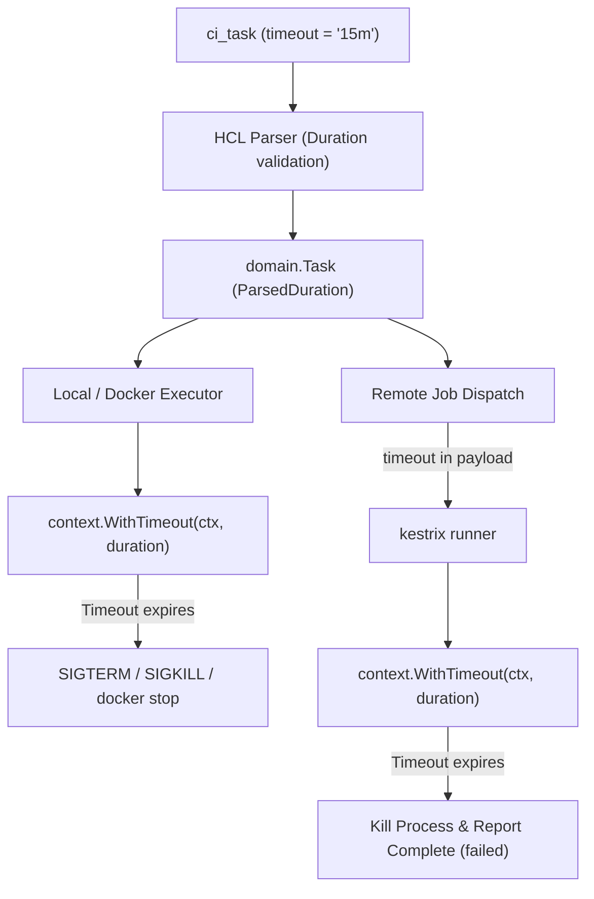

# Design: task-timeout

## Context

Without execution timeouts, misconfigured tasks (such as interactive scripts or infinite loops) run until an operator cancels them manually. This occupies runner slots and blocks subsequent queued runs. Adding a declarative `timeout` attribute to `ci_task` enables bounded execution across all executors (`local`, `docker`, and `remote`).

## Architecture

## Goals / Non-Goals

**Goals:**
- Provide declarative, user-configurable timeouts per task in HCL pipeline definitions.
- Enforce cancellation and termination across `local`, `docker`, and `remote` execution environments.
- Provide clear error messaging (`task execution timed out after <duration>`) on task results and UI.
- Skip dependent tasks when a prerequisite task times out.

**Non-Goals:**
- Dynamic script-level timeout adjustments during task runtime.
- Microsecond timing granularity (evaluated via standard Go `time.Duration`).

## Decisions

### 1. `time.ParseDuration` standard format
- **Chosen:** Accept duration strings compatible with standard Go `time.ParseDuration` (e.g., `10s`, `15m`, `1h30m`).
- **Rationale:** Familiar to Go, Terraform, and DevOps practitioners; robust parsing without custom grammar.

### 2. Context deadline propagation
- **Chosen:** Wrap the execution context with `context.WithTimeout(ctx, task.ParsedDuration())`.
- **Rationale:** Standard idiomatic Go pattern. All existing cancel routines (`cancelGrace`, SIGTERM, SIGKILL) trigger automatically when the context is cancelled due to deadline expiration.

### 3. Remote runner payload inclusion
- **Chosen:** Carry the declared timeout via `Task.Timeout` in `RemoteJobPayload` (no separate seconds field); the runner reads `job.Payload.Task.Timeout` directly.
- **Rationale:** Eliminates duplicate sources of truth and duration truncation. The remote runner process executes the task locally and enforces the deadline via `Task.ParsedDuration()`, reporting the timeout cleanly back to Kestrix before the server-side reclaim timer fires.

## Security Considerations

- Rejects negative or unparseable duration values at pipeline parse time, preventing integer overflows or underflows.
- Process group termination ensures child or background processes spawned by shell scripts are killed when the timeout expires.

## Risks / Trade-offs

- **[Runner reclaim vs. task timeout conflict]** → If task timeout exceeds server silent runner reclaim timeout (`KESTRIX_RUNNER_REMOTE_JOB_TIMEOUT`), the runner's periodic heartbeat in trace streaming keeps the job claimed.
