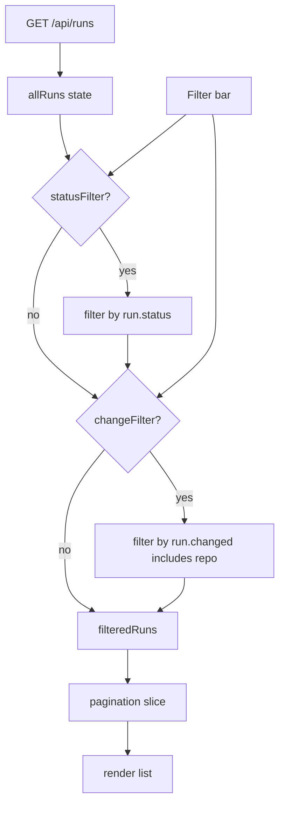

## Context

The `/pipelines` route renders the `RunList` component. It loads all pipeline runs via `GET /api/runs` and renders them in a single list. As the number of runs grows, users struggle to find the run they care about. This change adds a small filter bar to the existing page.

## Goals / Non-Goals

**Goals:**
- Add a filter bar above the run list in `RunList`.
- Allow filtering by run **status** (multi-select).
- Allow filtering by **changed repository** (single-select dropdown populated from loaded runs).
- Keep filters client-side so no backend changes are required.
- Update the empty-change label from `Changed: none` to `no changes`.
- Preserve the existing pagination behaviour; filtering should reduce the set that pagination slices.

**Non-Goals:**
- Server-side filtering or new API query parameters.
- Persistent filter state across sessions.
- Date-range, full-text, or advanced search.
- Bulk actions on filtered results.

## Decisions

1. **Client-side filtering**
   - `GET /api/runs` already returns the most recent 100 runs. For the current MVP scale, filtering in the browser is sufficient and avoids backend work.
   - *Alternative considered:* add query params to `/api/runs`. Rejected because it is unnecessary complexity for a basic filter bar at this stage.

2. **Filter state lives in React state**
   - Two pieces of state: `statusFilter` (array of strings) and `changeFilter` (string or `''`).
   - The list is computed as `allRuns.filter(...)` before pagination slices it.

3. **Status filter as multi-select**
   - Status values come from the existing `formatStatus` helper: `passed`, `failed`, `running`, `canceled`, `manual`, `skipped`, `pending`.
   - MUI `Select` with `multiple` and `Chip` render value is used for a compact UI.

4. **Change filter as single-select dropdown**
   - Unique repository names are derived from `run.changed` arrays of all loaded runs.
   - A blank option clears the filter.

5. **No URL query parameters for filters**
   - Keeping the implementation minimal. Pagination params (`page`, `limit`) remain in the URL, but filter state resets on page refresh.
   - *Future improvement:* sync filters to URL query params so filtered views are shareable.

## Architecture

## Security Considerations

- No new API endpoints are introduced.
- Filter inputs are rendered through MUI controlled components; values are compared against known status strings and repository names already present in loaded data.
- No user-supplied strings are sent to the backend as part of this feature.

## Risks / Trade-offs

- **Incomplete results on large histories** – `listAllRuns` caps results at 100. Filtering client-side can only operate on that subset.
  - *Mitigation:* Document limitation; move to server-side filtering if the run history grows beyond the UI cap.
- **Performance with many unique repos** – The change filter dropdown could become long if a monorepo contains dozens of repositories.
  - *Mitigation:* Keep the dropdown sorted alphabetically; consider an autocomplete if it grows further.
- **Filter + pagination interaction** – Changing a filter should reset the current page to 1 so the user does not land on an empty page.
  - *Mitigation:* Reset `offset`/`page` to 0 whenever a filter changes.

## Migration Plan

1. Implement the filter bar and label change in `ui/src/pages/Pipelines.jsx`.
2. Add or update UI tests for filtering logic.
3. Run `make test` and `npm run build`.
4. Deploy the updated UI; no backend deployment is needed.

## Open Questions

- Should filter state also be persisted in the URL so filtered views are shareable?
- Should the status filter default to hiding `pending`/`manual` runs, or start with all statuses selected?
